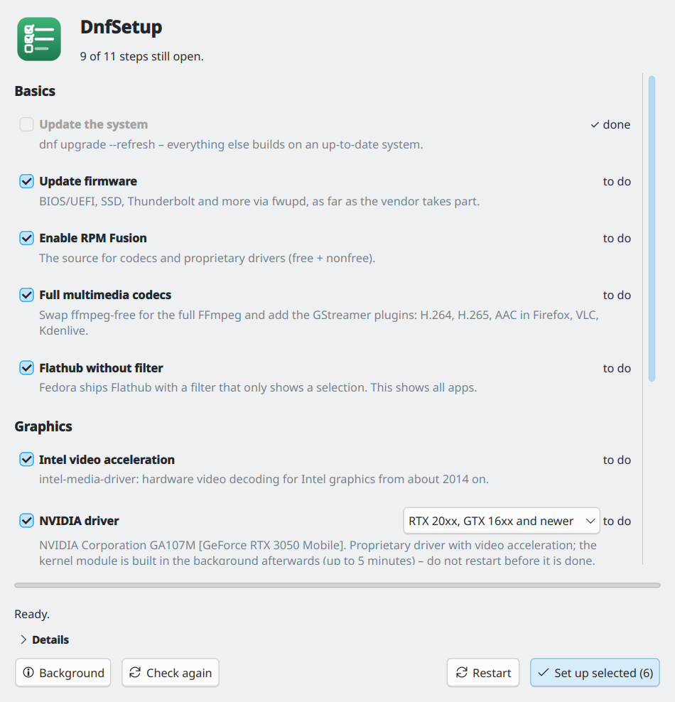

# DnfSetup

<p>
  
  <a href="https://github.com/TechnikWeber/DnfSetup/releases/latest"></a>
  <a href="https://github.com/TechnikWeber/DnfSetup/actions/workflows/ci.yml"></a>
  
  
  <a href="LICENSE"></a>
</p>

Set up Fedora after installation from one window: firmware, RPM Fusion,
multimedia codecs, graphics drivers, Flathub and a few extras. It shows what is
already done, you tick the rest and enter your password once.



The steps are the ones from
[Fedora KDE: was nach der Installation zu tun ist](https://technikweber.github.io/2026/fedora-kde-nach-der-installation/)
(German blog post), **checked on Fedora 45**. On other releases the window says
so; most steps work the same, but package names can change between releases.

## Steps

| Step | What runs |
|---|---|
| Update the system | `dnf upgrade --refresh` |
| Update firmware | `fwupdmgr refresh` + `fwupdmgr update` |
| Enable RPM Fusion | free + nonfree release packages and their AppStream data, so Discover lists RPM Fusion software |
| Full multimedia codecs | `dnf swap ffmpeg-free ffmpeg`, `@multimedia` group |
| Intel / AMD video acceleration | `intel-media-driver` / `mesa-*-freeworld` – only shown for the GPUs in the machine |
| NVIDIA driver | `akmod-nvidia` (RTX 20xx, GTX 16xx and newer), `-580xx` (GTX 9xx/10xx), `-470xx` (GeForce 600/700), picked from the card name and changeable |
| Flathub without filter | `flatpak remote-modify --no-filter --enable flathub` |
| Remove the duplicate Flathub | a user-level Flathub next to the system one makes Discover list every app twice |
| If needed | fonts metric-compatible with Arial, Times, Courier, Calibri and Cambria (Liberation, Carlito, Caladea), OBS Studio as RPM, DVD playback (`libdvdcss`), `fuse` for older AppImages |

Steps that need RPM Fusion tick it automatically. With **Secure Boot** on, the
NVIDIA step is not pre-ticked: the module must be signed first
([RPM Fusion guide](https://rpmfusion.org/Howto/Secure%20Boot)). After an NVIDIA
install the **Restart** button stays locked until akmods has built the kernel
module – restarting earlier ends with a black screen.

## Download

From the [latest release](https://github.com/TechnikWeber/DnfSetup/releases/latest):

| File | For |
|---|---|
| `dnfsetup-*-x86_64.AppImage` | Download, make executable, run. Or open it with [Gear Lever](https://flathub.org/apps/it.mijorus.gearlever), which also updates it. |
| `dnfsetup-*.noarch.rpm` | `sudo dnf install ./dnfsetup-*.noarch.rpm`. Uses the system Qt, so it looks native and is tiny. |

Or from the source, for your user only:

```bash
git clone https://github.com/TechnikWeber/DnfSetup.git
cd DnfSetup
./install.sh      # menu entry + `dnfsetup` command; ./uninstall.sh removes them
```

For keeping the system up to date afterwards, see the sibling project
[DnfPilot](https://github.com/TechnikWeber/DnfPilot).

## Good to know

* The often recommended `msttcore-fonts-installer` RPM has no digests and is
  refused by rpm on Fedora 45, so DnfSetup installs the free metric-compatible
  fonts instead.

* Every command is shown under **Details** while it runs.
* Not affiliated with the Fedora Project or RPM Fusion.

## License

[MIT](LICENSE).
